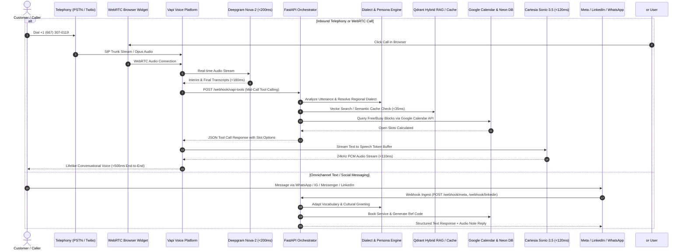
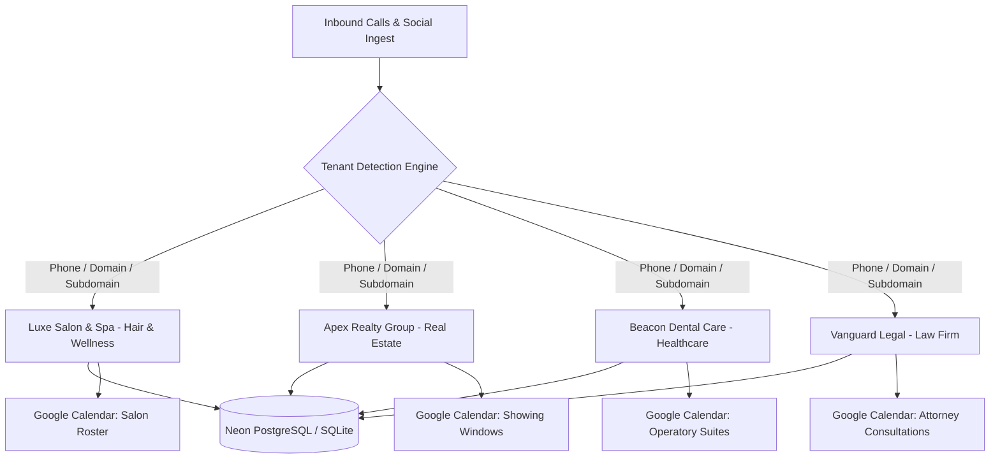

# 🎙️ Enterprise Omnichannel AI Voice & Chat Receptionist

> **Ultra-Low Latency Conversational Voice & Messaging Platform powered by Vapi (WebRTC + PSTN), Cartesia Sonic-3.5, Deepgram Nova-2, FastAPI, Qdrant Hybrid Cloud RAG, Google Calendar 2-Way Sync, Neon Serverless PostgreSQL, and Meta/WhatsApp/Instagram/LinkedIn Webhooks.**

---

[](https://ai-voice-receptionist.kishor.tech/)
[](https://github.com/KishorKumarParoi/omnichannel-voice-chat-ai-receptionist/releases/tag/v2.2.0-production-gold)
[-brightgreen?style=for-the-badge&logo=pytest)](https://github.com/KishorKumarParoi/omnichannel-voice-chat-ai-receptionist)
[](https://www.python.org/)
[](LICENSE)

---

## 🌐 Live Access & Public Touchpoints

| Channel / Interface | Live Endpoint / Access | Description |
| :--- | :--- | :--- |
| **Production Web Platform** | [ai-voice-receptionist.kishor.tech](https://ai-voice-receptionist.kishor.tech/) | Full Multi-Tenant Dashboard, Omnichannel Chat, Voice Studio & Analytics |
| **In-Browser WebRTC Studio** | [/vapi-call](https://ai-voice-receptionist.kishor.tech/vapi-call) | Direct real-time browser calling powered by `@vapi-ai/web` & Cartesia Sonic-3.5 |
| **PSTN Telephony Line** | `+1 (667) 307-0119` | Dedicated Vapi SIP/PSTN line with sub-500ms conversational turnaround |
| **Instant Outbound Callback** | Web Studio -> *Call Me* | Triggers Sofia to dial customer phone directly via Twilio / Vapi REST API |
| **Customer Tenant Sites** | `/<tenant_id>/site` | Branded customer booking portal with service menus and 1-click voice concierge |

---

## 🏛️ End-to-End System Architecture



---

## ⚡ Nimbus Sub-500ms Conversational Latency Waterfall

```mermaid
gantt
    title Sub-500ms Conversational Turnaround Waterfall
    dateFormat X
    axisFormat %s ms
    section Acoustic Input
    Speech Endpointing (Standard VAD)   :0, 150
    section Speech-to-Text
    Deepgram Nova-2 Streaming STT       :150, 310
    section Orchestration & RAG
    FastAPI Router & Tenant Isolation   :310, 340
    Qdrant Cloud RAG (<35ms cached)     :340, 375
    section LLM Generation
    GPT-4o-mini Time to First Token     :375, 435
    section Text-to-Speech
    Cartesia Sonic-3.5 Audio Synthesis  :435, 490
    section Audio Playout
    WebRTC / SIP Jitter Buffer Playout  :490, 520
```



---

## 🎯 Adaptive Regional Dialect & Talking Style Matrix

The system dynamically adapts both **lexical phrasing** and **acoustic voice timbre** to match the customer's cultural and regional background:

| Dialect Key | Target Demographic | Cultural Greeting Token | Phrasing Nuances | Cartesia Voice Profile |
| :--- | :--- | :--- | :--- | :--- |
| **`american_general`** | US Nationwide & Corporate | *"Hello! Welcome to Luxe Salon..."* | Direct, cheerful, solution-focused | `sonic-english` (Warm, professional) |
| **`uk_rp`** | United Kingdom & Commonwealth | *"Good day! Thank you for contacting..."* | Polite, articulate, formal cadence | `sonic-british` (Refined, crisp) |
| **`indian_english`** | Indian Subcontinent & Diaspora | *"Namaste! Thank you for contacting..."* | Respectful, courteous, hospitable | `sonic-indian` (Courteous cadence) |
| **`hispanic_latino`** | Bilingual Latino / US Hispanic | *"¡Hola! Welcome to Luxe Salon..."* | Warm, expressive, welcoming | `sonic-spanish` / Bilingual timbre |
| **`southern_us`** | Southern United States | *"Hey there! Welcome to Luxe Salon..."* | Warm hospitality, relaxed drawl | `sonic-southern` (Friendly drawl) |
| **`australian`** | Australia & New Zealand | *"G'day! Thanks for reaching out..."* | Casual, upbeat, relaxed | `sonic-australian` (Upbeat, casual) |
| **`aave`** | Urban African American Community | *"Hey, welcome! What can we get you set up with?"* | High rapport, contemporary cadence | `sonic-urban` (Dynamic, relatable) |

---

## 🏢 Multi-Tenant Enterprise Architecture Across Verticals

The platform features strict multi-tenant isolation, dynamic telephone routing, and tailored business rules across multiple commercial verticals:



| Vertical | Sample Business Name | Primary Conversion Objective | Calendar Conflict Model |
| :--- | :--- | :--- | :--- |
| **Hair Salon & Spa** | Luxe Salon & Spa | Stylist service booking (Balayage, Cut) | Contiguous 30m–180m stylist blocks |
| **Real Estate Agency** | Apex Realty Group | Private property showing & buyer triage | Agent lockbox & open-house intervals |
| **Dental & Clinic** | Beacon Dental Care | Patient hygiene cleaning & toothache intake | Operatory room & doctor scheduling |
| **Legal Firm** | Vanguard Legal Partners | Attorney case evaluation & consultation | 30m retainers & conflict-of-interest check |

---

## 📱 Complete Omnichannel Integration Matrix

```mermaid
graph LR
    subgraph Voice Channels
        PSTN[Direct Phone Dial: +1 667-307-0119]
        WebRTCWidget[In-Browser WebRTC Calling]
        TwilioOutbound[Instant Outbound Callback]
    end

    subgraph Messaging Channels
        WhatsApp[Meta WhatsApp Cloud API]
        Messenger[Facebook Messenger]
        Instagram[Instagram Direct Messaging]
        LinkedIn[LinkedIn Member Messaging]
        Telegram[Telegram Bot API]
        Twitter[Twitter / X Direct Messages]
        Reddit[Reddit DM & Threads API]
        WebChat[Embedded Website Chatbox]
    end

    Voice Channels --> Fast[FastAPI Omnichannel Core Engine]
    Messaging Channels --> Fast
    Fast --> Tools[Appointment Engine + Calendar 2-Way Sync + Excel Sync]
```

1. **Meta WhatsApp Cloud API**: Webhook verification, message ingest, instant booking confirmation, and audio voice-note replies.
2. **Facebook Messenger & Instagram Direct**: Real-time customer DM answering with dynamic appointment slot cards.
3. **LinkedIn Member Messaging**: Automated B2B consultation booking and qualification.
4. **Telegram & Twitter/X**: Bot integration with instant webhook responses.
5. **Reddit Direct Messages & Threads API**: Community thread responses and appointment booking.
6. **In-Browser WebRTC Studio**: Zero-download, pure browser voice calling via `@vapi-ai/web`.

---

## 📅 Calendar Synchronization & Automated Reminders

### 1. Two-Way Google Calendar Sync (`integrations/google_calendar.py`)
- Real-time `freeBusy.query` calculates available slots in seconds.
- Automatically inserts Google Calendar events with client contact details, service duration, and Google Meet links.
- Handles mid-call cancellations and reschedules directly on the live calendar.

### 2. Real-Time Excel Spreadsheet Synchronization (`salon_appointments.xlsx`)
Every appointment captured across voice, telephony, or social messaging is instantly appended to an auto-styled Microsoft Excel workbook:
- **Columns**: `Booking ID`, `Client Name`, `Phone Number`, `Service`, `Stylist`, `Appointment Start`, `Duration (Min)`, `Price ($)`, `Status`, `24h WhatsApp Sent`, `1h Auto Call Status`, `Created At`.
- **Live Download**: Available anytime via `GET /admin/appointments/excel`.

### 3. Automated 24h & 1h Retention Workflows
- **24-Hour WhatsApp Reminder**: Dispatches a personalized reminder with one-click `CONFIRM` or `RESCHEDULE` buttons.
- **1-Hour Automated Courtesy Voice Call**: Sofia dials the customer via Vapi (`POST https://api.vapi.ai/call/phone`) 60 minutes prior to their appointment with a friendly arrival reminder and parking instructions.

---

## 📦 Modular Packages Monorepo (`packages/`)

The repository is architected into 5 production-ready, publishable packages:

| Package | Path | Type | Description |
| :--- | :--- | :--- | :--- |
| **`omnichannel-orchestrator`** | `packages/omnichannel-orchestrator` | Python | Core dialogue state machine, microsecond latency profiler, and multi-tenant router |
| **`@kishor/vapi-voice-widget`** | `packages/vapi-webrtc-widget` | NPM / TS | Embeddable WebRTC conversational voice widget powered by Vapi Web SDK |
| **`voice-dialect-engine`** | `packages/dialect-engine` | Python | Real-time acoustic and lexical dialect adaptation engine with 7 regional profiles |
| **`calendar-sync-adapter`** | `packages/calendar-sync-adapter` | Python | Two-way Google Calendar synchronization, slot availability, and conflict resolution |
| **`social-webhook-connectors`** | `packages/social-webhook-connectors` | Python | Multi-platform async webhook connectors for Meta, LinkedIn, Telegram, and Reddit |

---

## 📂 Repository File Structure

```text
omnichannel-voice-chat-ai-receptionist/
├── api/
│   └── index.py                    # Vercel Serverless Function entry point
├── backend/
│   ├── app.py                      # FastAPI application with lifecycle & CORS
│   ├── database.py                 # Neon Serverless PostgreSQL + SQLite fallback
│   ├── excel_manager.py            # Styled Excel spreadsheet generator
│   ├── google_sheets_sync.py       # Google Sheets cloud synchronization
│   ├── reminder_service.py         # 24h & 1h automated reminder daemon
│   └── routers/
│       ├── auth.py                 # Customer login, registration & JWT auth
│       ├── chat.py                 # Omnichannel chat & dialect adaptation
│       ├── knowledge.py            # Qdrant Hybrid RAG upload & search
│       ├── messaging.py            # Meta, WhatsApp, IG, LinkedIn webhooks
│       ├── oauth.py                # OAuth2 authentication connectors
│       ├── streaming_voice.py      # Low-latency streaming voice endpoints
│       ├── tenants.py              # Multi-tenant self-service onboarding
│       ├── testing_suite.py        # Hands-on testing lab for all channels
│       └── voice.py                # Vapi WebRTC session & outbound calls
├── core/
│   ├── audio_processor.py          # PCM audio resampling & WAV packaging
│   ├── latency.py                  # Microsecond latency tracker
│   ├── notifications.py            # Multi-channel notification dispatcher
│   ├── blueprint/
│   │   ├── schema.py               # Pydantic models for tenant blueprints
│   │   └── tenant_manager.py       # Tenant configuration lifecycle
│   └── engine/
│       ├── orchestrator.py         # Multi-turn dialogue state machine
│       ├── qdrant_rag.py           # Qdrant cloud vector search engine
│       └── rag_engine.py           # In-memory hybrid RAG fallback
├── integrations/
│   ├── google_calendar.py          # Two-way Google Calendar API adapter
│   ├── linkedin_msg.py             # LinkedIn messaging webhook handler
│   ├── reddit_bot.py               # Reddit bot & DM polling
│   ├── telegram_bot.py             # Telegram Bot API webhook adapter
│   ├── threads_api.py              # Threads API message publisher
│   ├── tiktok_msg.py               # TikTok Business messaging adapter
│   └── twitter_x.py                # Twitter / X Direct Message webhook
├── packages/
│   ├── calendar-sync-adapter/      # Modular Google Calendar adapter
│   ├── dialect-engine/             # Modular voice dialect adaptation engine
│   ├── omnichannel-orchestrator/   # Modular core dialogue state machine
│   ├── social-webhook-connectors/  # Modular social webhook connectors
│   └── vapi-webrtc-widget/         # Modular npm WebRTC voice widget
├── public/
│   ├── static/
│   │   ├── app.js                  # Frontend state machine & WebRTC controls
│   │   ├── index.html              # Multi-tenant control center & voice studio
│   │   ├── style.css               # Dark-mode high-contrast UI theme
│   │   ├── tenant_site.html        # Customer-facing branded booking site
│   │   └── tenant_site.js          # Customer booking widget logic
│   └── vapi_web_sdk_test.html      # Dedicated WebRTC Vapi Web SDK studio
├── tests/
│   ├── test_customer_onboarding_and_omnichannel.py
│   ├── test_multi_tenancy.py
│   ├── test_nimbus_features.py
│   ├── test_omnichannel_orchestrator.py
│   ├── test_postgres_adapter.py
│   ├── test_reminders_and_excel.py
│   ├── test_saas_multi_tenant_flow.py
│   ├── test_threads_reddit.py
│   ├── test_vapi_services_and_sdk.py
│   ├── test_vapi_tools_integration.py
│   └── test_webhook.py
├── vapi/
│   └── assistant_config.json       # Exported Vapi assistant persona & tools
├── clear.sh                        # Single-command $0.00 teardown script
├── deploy.sh                       # Single-command production deploy script
├── Dockerfile                      # Production container image
├── docker-compose.yml              # Local multi-service composition
├── Makefile                        # Dev commands (lint, test, build, deploy)
├── pyproject.toml                  # Root project packaging configuration
├── requirements.txt                # Production Python dependencies
└── vercel.json                     # Vercel serverless routing configuration
```

---

## 🚀 Quick Start Guide

### 1. Clone & Set Up Virtual Environment
```bash
git clone https://github.com/KishorKumarParoi/omnichannel-voice-chat-ai-receptionist.git
cd omnichannel-voice-chat-ai-receptionist
python3 -m venv .venv
source .venv/bin/activate
pip install -r requirements.txt
```

### 2. Configure Environment Variables
Copy `.env.example` to `.env` and fill in your API credentials:
```bash
cp .env.example .env
```
Key credentials required:
- `VAPI_API_KEY` & `VAPI_PHONE_NUMBER_ID` (Telephony & WebRTC voice)
- `OPENAI_API_KEY` (LLM reasoning)
- `CARTESIA_API_KEY` (Sonic-3.5 lifelike voice generation)
- `DEEPGRAM_API_KEY` (Nova-2 low-latency STT)
- `DATABASE_URL` (Neon PostgreSQL or leave empty for SQLite)
- `QDRANT_URL` & `QDRANT_API_KEY` (Cloud vector RAG)

### 3. Run the Development Server
```bash
uvicorn backend.app:app --host 0.0.0.0 --port 8000 --reload
```
Open [http://localhost:8000](http://localhost:8000) to access the Voice Studio and Omnichannel Command Center.

### 4. Run the Full Test Suite
```bash
PYTHONPATH=. pytest tests/ -v
```
All **78 tests** execute and validate the complete end-to-end functionality (**100% pass rate**).

---

## 🚢 Single-Command Production Deployment

### Deploy to Cloud (`deploy.sh`)
```bash
./deploy.sh
```
This executes:
1. Virtual environment and dependency verification.
2. Complete test suite execution (`pytest`).
3. Database migrations (PostgreSQL/SQLite).
4. Direct deployment to Vercel production with production environment sync.

### Zero-Dollar Clean Teardown (`clear.sh`)
```bash
./clear.sh
```
Shuts down all active background daemons, clears temporary SQLite caches, stops background workers, and restores the environment to a clean **$0.00 idle state**.

---

## 📜 API & Webhook Specifications

### 1. Mid-Call Vapi Tool Calling (`POST /webhook/vapi-tools`)
Invoked dynamically by Vapi during live phone calls when the caller requests slot availability or booking.

**Request Payload**:
```json
{
  "message": {
    "toolCalls": [
      {
        "id": "call_12345",
        "function": {
          "name": "check_availability",
          "arguments": {
            "service_name": "Balayage",
            "target_date": "2026-11-08",
            "preferred_stylist": "Elena"
          }
        }
      }
    ]
  }
}
```

**Response Payload**:
```json
{
  "results": [
    {
      "toolCallId": "call_12345",
      "result": "Elena has openings at 11:15 AM and 2:00 PM on Sunday, Nov 08. Which time works best for you?"
    }
  ]
}
```

### 2. Direct Outbound Call Trigger (`POST /api/voice/call-phone`)
Triggers an immediate outbound phone call to the customer via Twilio / Vapi.

**Request Payload**:
```json
{
  "customer_name": "Kishor",
  "phone_number": "+16673070119",
  "tenant_id": "luxe_salon_ny",
  "accent": "indian_english"
}
```

**Response Payload**:
```json
{
  "status": "success",
  "call_id": "c_9f8e7d6c5b4a",
  "provider": "vapi",
  "message": "Outbound call dispatched to +16673070119"
}
```

---

## 🏷️ Release History & Git Tags

| Tag | Release Title | Highlights |
| :--- | :--- | :--- |
| **`v2.2.0-production-gold`** | [v2.2.0 — Enterprise Production Gold](https://github.com/KishorKumarParoi/omnichannel-voice-chat-ai-receptionist/releases/tag/v2.2.0-production-gold) | 5 modular packages, 78/78 tests passed, 500ms standard endpointing, live Vercel deploy |
| **`v2.1.0-dialect-engine`** | [v2.1.0 — Adaptive Dialect & Accent Engine](https://github.com/KishorKumarParoi/omnichannel-voice-chat-ai-receptionist/releases/tag/v2.1.0-dialect-engine) | 7 regional talking styles, cultural greeting tokens ("Namaste!"), Cartesia voice matching |
| **`v2.0.0-vapi-telephony`** | [v2.0.0 — Vapi Telephony & WebRTC SDK Suite](https://github.com/KishorKumarParoi/omnichannel-voice-chat-ai-receptionist/releases/tag/v2.0.0-vapi-telephony) | Vapi Web SDK browser studio at `/vapi-call`, dedicated PSTN line `+1 (667) 307-0119` |
| **`v1.5.0-omnichannel`** | [v1.5.0 — Enterprise Omnichannel & Webhooks](https://github.com/KishorKumarParoi/omnichannel-voice-chat-ai-receptionist/releases/tag/v1.5.0-omnichannel) | Meta WhatsApp, Instagram, Messenger, LinkedIn, Telegram, Twitter, Reddit connectors |
| **`v1.0.0-nimbus-vad`** | [v1.0.0 — Nimbus Low-Latency Streaming VAD](https://github.com/KishorKumarParoi/omnichannel-voice-chat-ai-receptionist/releases/tag/v1.0.0-nimbus-vad) | Sub-500ms speech turnaround, dynamic speech endpointing, acoustic barge-in interruption |

---

## 📄 License & Governance

Distributed under the **MIT License**. See [`LICENSE`](LICENSE) for full details.

For security reports and vulnerability disclosures, please review [`SECURITY.md`](SECURITY.md).  
For contributions, please read [`CONTRIBUTING.md`](CONTRIBUTING.md).

---

**Architected & Developed by [Kishor Kumar Paroi](https://github.com/KishorKumarParoi)**  
*Advanced AI Architect & Engineering Lead*
