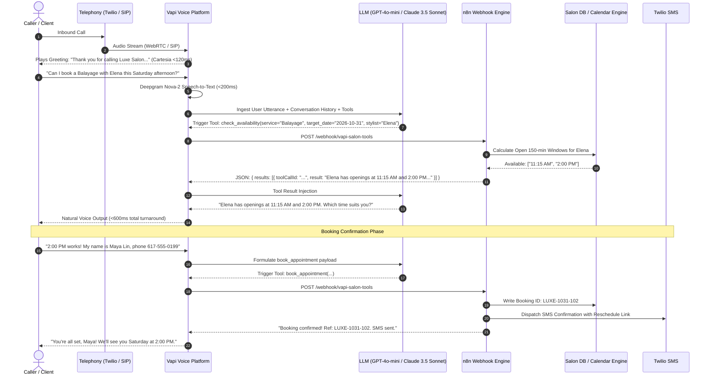

# 💇‍♀️ Luxe Salon AI Voice Receptionist (Vapi + n8n)

> A production-grade, low-latency conversational AI Voice Receptionist tailored for Hair Salons, Spas, and Wellness Studios. Powered by **Vapi** (orchestration, Deepgram Nova-2 STT, Cartesia TTS) and **n8n** (workflow automation, calendar slot calculation, SMS confirmation, and CRM sync).

---

## 🏛️ System Architecture



---

## ⚖️ Trade-Off Analysis

| Dimension | Standard IVR / Phone Tree | Raw Webhook Script | Vapi + n8n Architecture (This Project) |
| :--- | :--- | :--- | :--- |
| **User Experience** | Robotic "Press 1 for Haircut" | Rigid, fragile parsing | **Human-grade, warm conversational voice (<600ms latency)** |
| **Service Duration Handling** | Cannot calculate block times | Hardcoded intervals | **Dynamic 30m–180m duration conflict resolution** |
| **Development Velocity** | Months of telephony code | Weeks of custom backend | **Hours via visual n8n pipelines & JSON schemas** |
| **Extensibility** | Low | High maintenance | **500+ n8n connectors (Google Calendar, Twilio, HubSpot)** |
| **Operating Cost** | $0.05/min (dumb IVR) | $0.08/min | **~$0.11/min (Deepgram + Cartesia + GPT-4o-mini)** |

---

## 💇 Salon Domain Nuances Handled

1. **Service Duration Awareness**:
   - *Haircut*: 45 mins.
   - *Balayage*: 150 mins (2.5 hours).
   - The engine automatically checks for contiguous free blocks rather than simple 30-min slots to prevent double-booking.
2. **Stylist Selection**:
   - Clients can ask for specific stylists (*Elena, Marcus, Chloe*) or choose "Any available".
3. **Rescheduling & Cancellation Safeguards**:
   - Identifies appointments by caller phone number.
   - Respects 24-hour notice policy before waiving fees.
4. **Human Manager Escalation**:
   - If a caller mentions dissatisfaction, color corrections, or wedding parties, the `transfer_to_manager` tool connects them directly to front-desk staff.

---

## 🏢 Multi-Tenant SaaS & White-Label Architecture

### 1. Inbound Phone Number Dynamic Routing
Each salon is assigned their own local phone number (e.g. via Twilio/Vapi). When an inbound call arrives, the system detects the dialed number and dynamically isolates:
- **Salon Identity**: Uses their exact salon name, address, and cancellation policy in the voice prompt.
- **Stylist Roster**: Queries only the stylists employed by that specific tenant.
- **Services & Pricing**: Checks durations and prices configured by that salon.

### 2. White-Label Admin Portal (`admin_portal.py`)
Launch the web command center:
```bash
./run_admin_portal.sh
```
- **Salon Tenant Switcher**: View metrics and appointments across all your onboarded salons.
- **Live KPI Dashboard**: Total bookings, estimated revenue captured, 24h WhatsApp reminders sent, and 1h voice calls completed.
- **1-Click Master Excel Download**: Download the auto-formatted Excel workbook.
- **60-Second Onboarding Form**: Provision a new salon customer without writing any code.

### 3. Rapid CLI Client Onboarding (For Live Demos)
Onboard a new salon in 30 seconds straight from your terminal:
```bash
python3 scripts/onboard_new_salon.py \
  --name "SoHo Cuts NYC" \
  --phone "+12125550199" \
  --address "128 Prince St, New York, NY" \
  --stylists "Leo,Maya,Jordan"
```
This automatically creates their database record and generates a tailored Vapi Assistant JSON in `vapi/tenants/soho_cuts_nyc_assistant.json`.

---

## 📊 Excel Sheet & Automated Reminder Workflows

### 1. Real-Time Excel Spreadsheet Sync (`salon_appointments.xlsx`)
Every appointment booked by the voice agent is saved both to the database and directly to a styled, auto-formatted Excel workbook:
- **Columns**: `Booking ID`, `Client Name`, `Phone Number`, `Service`, `Stylist`, `Appointment Start`, `Duration (Min)`, `Price ($)`, `Status`, `24h WhatsApp Sent`, `1h Auto Call Status`, `Created At`.
- **Live Download**: Access anytime via `GET http://localhost:8000/admin/appointments/excel`.

### 2. WhatsApp Notification (24 Hours Prior)
24 hours before the appointment, the background reminder daemon automatically scans the bookings and delivers a personalized WhatsApp message:
> *"✨ Luxe Salon Reminder ✨: Hi [Name], you have a Balayage with Elena scheduled tomorrow at 2:00 PM. Address: 450 Newbury St, Boston. Reply CONFIRM or reply to reschedule."*
- Marks `24h WhatsApp Sent = SENT` in the Excel spreadsheet and database.

### 3. Automated Voice Courtesy Call & Alert (1 Hour Prior)
60 minutes before the scheduled service, the system triggers an automated outbound voice call via **Vapi** (`POST https://api.vapi.ai/call/phone`) with assistant persona Sophia:
> *"Hi [Name]! This is Sophia from Luxe Salon. Just giving you a quick courtesy call to remind you that your appointment with [Stylist] starts in one hour! We have your station ready. See you soon!"*
- Also dispatches an urgent 1-hour WhatsApp reminder with parking instructions.
- Marks `1h Auto Call Status = CALLED` in Excel.

---

## 📁 Repository Structure

```text
Salon_Voice_AI_Receptionist/
├── vapi/
│   └── assistant_config.json      # Full Vapi assistant persona, prompts, and tools
├── n8n/
│   └── workflows/
│       └── salon_voice_receptionist_workflow.json  # Importable 1-click n8n workflow
├── backend/
│   ├── app.py                     # High-performance FastAPI tool-router
│   ├── models.py                  # Pydantic validation schemas
│   └── database.py                # Duration-aware slot calculator & SQLite store
├── tests/
│   └── test_webhook.py            # Pytest test suite for Vapi tool-calling
├── docker-compose.yml             # Local multi-service orchestrator
├── Dockerfile                     # Container definition
├── deploy.sh                      # Single-command start script
└── clear.sh                       # Single-command $0.00 teardown script
```

---

## 🚀 Quick Start Guide (End-to-End Live)

### 1. Launch FastAPI Backend + Live Cloudflare Tunnel (One Command)
```bash
./start_live_tunnel.sh
```
This automatically:
- Spawns the high-throughput FastAPI webhook engine.
- Creates an HTTPS Cloudflare Tunnel (`https://<domain>.trycloudflare.com`).
- Updates [`vapi/assistant_config.json`](vapi/assistant_config.json) with your live webhook URL.
- Runs self-diagnostics and prints your public URL.

### 2. Stop Stack & Clean Teardown
```bash
./stop_live_tunnel.sh
```
Or for full $0.00 teardown:
```bash
./clear.sh
```

### 2. Configure Vapi
1. Go to [Vapi Dashboard](https://dashboard.vapi.ai) -> **Assistants** -> **Create Assistant**.
2. Select **Model**: `gpt-4o-mini`, **Transcriber**: `Deepgram nova-2`, **Voice**: `Cartesia (Sonic English)`.
3. In **Assistant Settings**, copy and paste the JSON from [`vapi/assistant_config.json`](vapi/assistant_config.json).
4. Set the **Server URL** to your public n8n or FastAPI webhook URL (e.g., using `ngrok http 8000` or Cloudflare Tunnel: `https://<your-subdomain>.ngrok-free.app/webhook/vapi-tools`).

### 3. Test Mid-Call Tool Calls via cURL
Test checking availability for a 150-minute Balayage:
```bash
curl -X POST http://localhost:8000/webhook/vapi-tools \
  -H "Content-Type: application/json" \
  -d '{
    "message": {
      "toolCalls": [
        {
          "id": "call_sample_001",
          "function": {
            "name": "check_availability",
            "arguments": {
              "service_name": "Balayage",
              "target_date": "2026-11-02",
              "preferred_stylist": "Elena"
            }
          }
        }
      ]
    }
  }'
```

### 4. Run the Test Suite
```bash
make test
```

### 5. Teardown ($0.00 State)
```bash
./clear.sh
```

