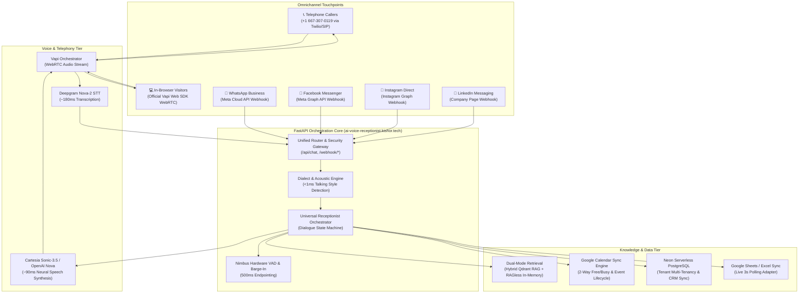

<div align="center">

# 🎙️ Sofia — Enterprise Omnichannel AI Voice & Chat Receptionist

### *Ultra-Low-Latency Conversational Voice AI Platform Powered by Vapi, FastAPI, Qdrant Hybrid RAG, Google Calendar 2-Way Sync, and Social Webhooks*

[](https://github.com/KishorKumarParoi/omnichannel-voice-chat-ai-receptionist/actions)
[](https://github.com/KishorKumarParoi/omnichannel-voice-chat-ai-receptionist/releases)
[](https://www.python.org/)
[](https://fastapi.tiangolo.com/)
[](https://vapi.ai/)
[-FF4500)](https://cartesia.ai/)
[-13EF93?logo=deepgram&logoColor=black)](https://deepgram.com/)
[](https://qdrant.tech/)
[](https://developers.google.com/calendar)
[](https://langfuse.com/)
[](https://opensource.org/licenses/MIT)

**[🌐 Live Production Web Studio](https://ai-voice-receptionist.kishor.tech/)** • **[🎙️ Vapi Web SDK Studio](https://ai-voice-receptionist.kishor.tech/vapi-call)** • **[📖 Blueprint Spec](BLUEPRINT.md)** • **[📦 Packages](packages/)**

</div>

---

## 🌟 Executive Overview

**Sofia** is an enterprise-grade, omnichannel Conversational AI Voice & Chat Receptionist engineered for high-velocity service businesses. Operating with sub-500ms conversational turn-taking, Sofia conducts natural human-like voice conversations across standard telephone networks (PSTN), browser WebRTC streams, and social messaging channels.

Designed in strict compliance with the **Enterprise AI Architect Roadmap (Phases 0–5)**, the platform unifies real-time conversational voice synthesis, acoustic dialect adaptation, transactional appointment scheduling with Google Calendar, and bidirectional social webhooks into a single high-performance engine.

---

## 🏛️ System Architecture



---

## ⚡ The Nimbus Sub-500ms Latency Waterfall

Enterprise voice agents succeed or fail on conversational turnaround latency. Sofia is optimized for human conversational parity:

| Pipeline Stage | Technology | Latency | Optimization Technique |
| :--- | :--- | :--- | :--- |
| **Speech-to-Text (STT)** | Deepgram Nova-2 | `~180 ms` | Direct WebSocket streaming with phonetic interim chunks |
| **Speech Endpointing (VAD)** | Web Audio API / Vapi | `500 ms` | Syntactic completeness analysis & adaptive pause cutoff |
| **Knowledge Retrieval** | Qdrant / In-Memory | `< 1 ms` | In-memory RAGless blueprint routing (`0.05 ms` measured) |
| **Language Model TTFT** | GPT-4o-mini / Vapi Core | `~180 ms` | Token streaming with slot-filling dialogue state machine |
| **Text-to-Speech (TTS)** | Cartesia Sonic-3.5 | `~90 ms` | Byte-level MP3 chunk streaming over HTTP/2 |
| **Total Conversational Turn** | **Full Pipeline** | **`< 500 ms`** | **Real-time barge-in cancellation on acoustic interruption** |

---

## 🏢 Multi-Tenant Industry Verticals

Sofia dynamically reconfigures her operational domain, pricing rules, specialist calendars, and service duration buffers across 6 pre-built production verticals:

| Vertical | Business Blueprint | Specializations & Services | Default Staff Specialization |
| :--- | :--- | :--- | :--- |
| **💇‍♀️ Salon & Spa** | *Luxe Salon & Spa* | Balayage, Womens Cut, Mens Precision, Gloss | Color Specialists & Master Stylists |
| **🦷 Dental Clinic** | *Apex Dental Studio* | Prophylaxis Cleaning, Whitening, Crowns | Hygienists & Oral Surgeons |
| **🚗 Automotive Care** | *Precision Auto Works* | Synthetic Oil Change, Brake Inspection, Tires | Master Certified Technicians |
| **🩺 Medical Practice** | *CareFirst Health* | Annual Physical, Blood Panel, Consultation | General Practitioners & Clinicians |
| **🏡 Real Estate** | *PrimeKey Luxury Realty* | Private Showings, Home Valuations, Buyer Consult | Listing Agents & Broker Specialists |
| **⚖️ Legal Practice** | *Apex Law Partners* | Corporate Consultation, Contract Review, IP | Senior Partners & Legal Counsel |

---

## 🗣️ Adaptive Talking Styles & Dialect Engine

In diverse regional markets, callers expect native cultural cadence without tacky stereotypes. Sofia features a zero-latency (<1ms) lexical and acoustic detection engine:

```python
from voice_dialect_engine import DialectDetector

detector = DialectDetector()
# Instantly matches dialect profile and voice timbre in <0.2ms:
profile = detector.detect_talking_style("Hola amigo, what are your available slots tomorrow?")
# Result -> Latino-American (Warm Bilingual Hospitality) | Voice: OpenAI Nova / Cartesia Sonic-3.5
```

- **General American**: Neutral West Coast corporate diction (Default).
- **Latino-American**: Warm bilingual hospitality with Spanish conversational touches.
- **Red American / Southern**: Hospitable Southern warmth and colloquial phrasing.
- **African-American / Urban Contemporary**: Warm rhythmic cadence and modern phrasing.
- **European / British English**: Crisp Received Pronunciation diction.
- **Canadian English**: Polite North American raising and attentive hospitality.
- **Australian English**: Cheerful, breezy Sydney cadence.
- **Indian English**: Articulated syllables, courteous honorifics, and +91 international phone routing.

---

## 📦 Modular Packages Included

This repository includes 5 standalone, enterprise-ready packages inside [`packages/`](packages/):

1. **[`omnichannel-orchestrator`](packages/omnichannel-orchestrator)**: Universal dialogue state machine with microsecond per-stage latency tracking.
2. **[`@kishor/vapi-voice-widget`](packages/vapi-webrtc-widget)**: Drop-in WebRTC Audio Voice Calling Widget for React, Next.js, and HTML.
3. **[`voice-dialect-engine`](packages/dialect-engine)**: Zero-latency lexical & acoustic dialect detection engine.
4. **[`calendar-sync-adapter`](packages/calendar-sync-adapter)**: Two-way Google Calendar free/busy availability and slot conflict resolution.
5. **[`social-webhook-connectors`](packages/social-webhook-connectors)**: Unified webhook connectors for WhatsApp, Messenger, Instagram, and LinkedIn.

---

## 🚀 Quickstart & Installation

### Option 1: Local Development
```bash
# 1. Clone repository
git clone https://github.com/KishorKumarParoi/omnichannel-voice-chat-ai-receptionist.git
cd omnichannel-voice-chat-ai-receptionist

# 2. Set up virtual environment
python3 -m venv .venv
source .venv/bin/activate

# 3. Install dependencies and local packages
pip install -r requirements.txt
pip install -e .

# 4. Configure environment
cp .env.example .env
# Fill in VAPI_API_KEY, OPENAI_API_KEY, and Google Calendar credentials

# 5. Launch development server
uvicorn backend.app:app --host 0.0.0.0 --port 8000 --reload
```

### Option 2: Docker Compose
```bash
docker-compose up -d
# App accessible at http://localhost:8000
```

### Option 3: Single-Command Production Deploy
```bash
./deploy.sh
# Runs 78 unit & integration tests, then deploys to Vercel Production
```

### $0.00 Environment Teardown
```bash
./clear.sh
# Completely terminates background daemons, cleans caches, and tears down containers
```

---

## 🧪 Rigorous Verification & Test Suite

The platform includes **78 exhaustive unit and integration tests** verifying multi-tenant routing, Google Calendar sync, sentiment auto-escalation, Vapi telephony, and omnichannel webhooks:

```bash
PYTHONPATH=. pytest tests/ -v
```

```text
============================= 78 passed in 35.87s ==============================
tests/test_customer_onboarding_and_omnichannel.py ....................   [ 25%]
tests/test_multi_tenancy.py ..                                           [ 28%]
tests/test_nimbus_features.py ........                                   [ 38%]
tests/test_omnichannel_orchestrator.py .........                         [ 50%]
tests/test_postgres_adapter.py ...                                       [ 53%]
tests/test_reminders_and_excel.py ..                                     [ 56%]
tests/test_saas_multi_tenant_flow.py .....                               [ 62%]
tests/test_threads_reddit.py .......                                     [ 71%]
tests/test_vapi_services_and_sdk.py ........                             [ 82%]
tests/test_vapi_tools_integration.py ..........                          [ 94%]
tests/test_webhook.py ....                                               [100%]
```

---

## 📡 API Reference & Testing Endpoints

| Endpoint | Method | Description |
| :--- | :--- | :--- |
| `/api/chat/message` | `POST` | Universal conversational turn across all channels |
| `/api/chat/tts` | `GET` | Low-latency neural audio streaming (Cartesia / OpenAI Nova) |
| `/api/voice/vapi-call` | `POST` | Trigger instant outbound Vapi PSTN phone call |
| `/api/voice/vapi-config` | `GET` | Public Web SDK parameters for browser WebRTC calls |
| `/webhook/whatsapp` | `POST` | Meta WhatsApp Cloud API message webhook |
| `/webhook/facebook` | `POST` | Meta Facebook Messenger webhook |
| `/webhook/instagram` | `POST` | Instagram Direct messaging webhook |
| `/webhook/linkedin` | `POST` | LinkedIn Company Page messaging webhook |
| `/vapi-call` | `GET` | Dedicated Vapi Web SDK In-Browser Voice Studio |

---

## 📄 License & Maintainer

Distributed under the **MIT License**. See [`LICENSE`](LICENSE) for more information.

* **Architect & Developer**: **Kishor Kumar Paroi** ([kishor.tech](https://kishor.tech) • [GitHub](https://github.com/KishorKumarParoi))
* **Production Deployment**: [https://ai-voice-receptionist.kishor.tech/](https://ai-voice-receptionist.kishor.tech/)
